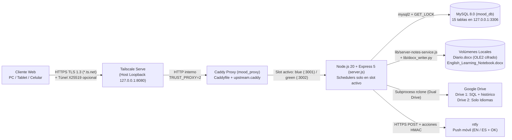

# 🧠 Conceptos Técnicos y Arquitectura — Personal Daily Hub

> Documento maestro de referencia técnica para entender **cómo** y **por qué** está diseñado cada subsistema de `personal-daily-hub` (`mood-tracker`), su modelo de seguridad criptográfica, concurrencia en despliegues Blue-Green, motores de recordatorios inteligentes, procesamiento de letras/OOXML e internacionalización bilingüe.

---

## 📑 Índice de Contenidos

1. [Arquitectura General y Flujo de Red](#1-arquitectura-general-y-flujo-de-red)
2. [Seguridad, Autenticación y Criptografía](#2-seguridad-autenticación-y-criptografía)
3. [Concurrencia, Locks Distribuidos y Tiempo Real (SSE)](#3-concurrencia-locks-distribuidos-y-tiempo-real-sse)
4. [Notificaciones Inteligentes, Agenda Jira, Horario y Motor Bilingüe (`EN / ES`)](#4-notificaciones-inteligentes-agenda-jira-horario-y-motor-bilingüe-en--es)
5. [Procesamiento de Letras e Integridad OOXML (`.docx`)](#5-procesamiento-de-letras-e-integridad-ooxml-docx)
6. [Infraestructura Blue-Green en un Solo Nodo Ubuntu](#6-infraestructura-blue-green-en-un-solo-nodo-ubuntu)
7. [Glosario Técnico Rápido](#7-glosario-técnico-rápido)

---

## 1. Arquitectura General y Flujo de Red

**Personal Daily Hub** utiliza una arquitectura monolítica modular contenida en **Docker Compose** sobre **Ubuntu Server (8 GB RAM)**, sin exposición directa de puertos hacia Internet pública (`0.0.0.0`). Todo el tráfico remoto entra únicamente a través de la red privada **Tailscale** con terminación TLS 1.3.



### Principios de aislamiento de datos
1. **Separación estricta de almacenamiento:**
   * **MySQL (`mood_db`):** Guarda métricas numéricas, fechas, catálogo de canciones/lecciones (`0 KB` de letras), configuración (`ConfiguracionUsuario`) y estados de sincronización (`SyncRevisions`).
   * **`./data/journal/Diario.docx`:** Vive **exclusivamente en disco local** del servidor cifrado con `WORD_PASSWORD` mediante OLE2 Agile Encryption (`msoffcrypto-tool`). **Nunca** se guarda texto del diario en MySQL ni se sube a Google Drive ni a Git.
   * **`./english-notes/English_Learning_Notebook.docx`:** Cuaderno de vocabulario, gramática, letras y alfabetos en formato OOXML abierto, respaldado opcionalmente en el canal independiente `STUDY_RCLONE_REMOTE`.

---

## 2. Seguridad, Autenticación y Criptografía

### 2.1 Control de Acceso Basado en Roles (RBAC), Sesiones y MFA

| Rol | Identidad | Alcance permitido |
| :--- | :--- | :--- |
| **`admin`** | Único propietario cuyo correo coincide exactamente con `ADMIN_EMAIL` (verificado con OTP o `ADMIN_SECRET` al registrarse). | Acceso completo a todos los módulos, escritura de diario/idiomas, agenda, planificador ITS, exportación `.docx`, administración de cuentas médicas y Ajustes. |
| **`psiquiatra`** | Cuentas creadas por el administrador desde `#view-medico` (`/api/auth/create-medico`) o verificadas con otro correo autorizado. | **Solo lectura clínica** en `#view-resumen` (`/api/get-moods`, `/api/get-sleep`, `/api/get-crisis`, `/api/archive/drive-range`) y scopes SSE limitados (`mood`, `sleep`, `crisis`). Bloqueado por `requireAdmin` en todo endpoint personal/escritura. |

* **Hashing de contraseñas:** `bcryptjs` con **12 rondas** (`BCRYPT_ROUNDS`).
* **Sesiones seguras (`SesionesAuth`):** La cookie `mt_session` (`HttpOnly`, `SameSite=Lax`, `Secure` cuando hay TLS) contiene un token aleatorio opaco de 64+ caracteres hex, mientras MySQL almacena únicamente su hash `SHA-256`.
* **Expiración y concurrencia:** Cada sesión caduca automáticamente el **domingo a las `00:00:00`**, existe un límite máximo de **3 sesiones activas** por usuario (`pruneExcessUserSessions`), y el navegador coordina pestaña única vía `BroadcastChannel('pdh_active_tab_channel_v1')` con handover automático al abrir enlaces desde notificaciones `ntfy` (`fromNtfy=1`).
* **MFA opcional:** Al habilitar `ENABLE_LOGIN_MFA=true`, el inicio de sesión emite un código temporal OTP de 6 dígitos en `CodigosSeguridad` por Gmail SMTP (`/api/auth/verify-login-mfa`) firmado con `MFA_CHALLENGE_SECRET`.

### 2.2 CSP Estricto (`script-src 'self'`) y Protección Anti-Autofill (`.secret-input-masked`)

* **Content Security Policy:** `server.js` emite encabezados estrictos con `script-src 'self'`, `connect-src 'self'`, `media-src 'self'` y `X-Frame-Options: DENY`. Ninguna vista protegida carga JS externo de CDN ni scripts inline ejecutables: CryptoJS se sirve localmente desde `public/vendor/crypto-js.min.js` y los mosaicos de mapa se sirven mediante el proxy autenticado `/api/planner/map-tile/:z/:x/:y.png`.
* **Anti-Autofill global (`initGlobalNoAutofillGuard()`):** Todos los formularios dentro de `#appShell` declaran `autocomplete="off"`. Los campos sensibles que no son contraseñas de login (llave E2EE `#e2eeKeyInput`, API Key de Gemini `#setGeminiApiKey`, contraseña de descarga `#setJournalDownloadPassword` / `#journalDownloadPasswordInput`, clave de médico `#medicoPassword`) emplean `<input type="text" class="secret-input-masked" data-secret-mask="true" autocomplete="off" data-lpignore="true">` en conjunto con `-webkit-text-security: disc` en `public/style.css` y atributo inicial `readonly` liberado al enfocar. Esto impide que administradores de contraseñas del navegador sobrescriban claves privadas o llenen formularios erróneos.

### 2.3 Túnel de Transporte Híbrido (`public/transport-crypto.js` ↔ `lib/transport-crypto.js`)

Además de TLS 1.3 en Tailscale, la aplicación soporta cifrado adicional a nivel de aplicación entre cliente y Express (`__enc: "x25519-aes256ctr-hmac-v1"`):
1. El cliente negocia llaves efímeras mediante escalera de Montgomery **Curve25519 (`X25519`)** en `POST /api/transport/handshake`.
2. Ambas partes derivan claves simétricas independientes (`encKey` y `macKey`) usando **HKDF-SHA256**.
3. Cada payload se cifra con **`AES-256-CTR`** e IV único de 16 bytes, autenticado mediante **`HMAC-SHA256`** verificado en tiempo constante (`crypto.timingSafeEqual`) antes de descifrar.
4. El servidor mantiene un **filtro LRU anti-replay de 512 IVs** por sesión para rechazar peticiones duplicadas o reinyectadas.

### 2.4 Cifrado E2EE del Diario con Salt (`pdh-j2`) y Descarga Segura en RAM

El diario personal aplica cifrado **de extremo a extremo en el navegador** antes de enviar cualquier carácter por red. Se mantiene una separación criptográfica deliberada entre el Diario y el Cuaderno de Idiomas:

| Flujo | Endpoint | Formato de sobre | Algoritmo |
| :--- | :--- | :--- | :--- |
| **Notas de Diario** | `POST /api/send-to-pc` | `pdh-j2:120000:<saltHex32>:<ivHex32>:<macHex64>:<cipherB64>` | `PBKDF2-HMAC-SHA256` (120,000 iter, salt aleatorio 16B) → 64B (`AES-256-CBC` + `HMAC-SHA256` Encrypt-then-MAC). |
| **Descarga `Diario.docx`** | `GET` / `POST /api/journal/download-encrypted` | `pdh-j2` sobre binario `.docx` Base64 | Descifrado OLE2 en RAM Python (`io.BytesIO`) + `encryptJournalSaltedBytesE2ee` con contraseña propia (`8–128` chars) + descifrado en navegador. |
| **Cuaderno de Idiomas** | `POST /api/send-english` | `<ivHex32>:<cipherB64>` | Clásico `AES-256-CBC` compatible con `encriptarTextoE2EE` en `public/frontend.js` y `sincronizador.py`. |

#### Flujo paso a paso de `pdh-j2` al enviar y al descargar `Diario.docx`:

```text
[Envío de Nota de Diario]
  Navegador (WebCrypto / CryptoJS)
    ├── Genera salt aleatorio (16 bytes) + IV aleatorio (16 bytes)
    ├── PBKDF2-HMAC-SHA256(JOURNAL_SECRET_KEY, salt, 120000) ──► encKey (32B) + macKey (32B)
    ├── Cifra nota UTF-8 con AES-256-CBC(encKey, iv) ──► cipherB64
    ├── Calcula HMAC-SHA256(macKey, "pdh-j2:120000:" + saltHex + ":" + ivHex + ":" + cipherB64)
    └── Envía sobre `pdh-j2:...` al servidor -> bajo lock `pdh_docx_journal` -> `docx_writer.py` escribe en Diario.docx cifrado con WORD_PASSWORD

[Descarga Segura de Diario.docx en RAM]
  Navegador solicita `/api/journal/download-encrypted`
    └── Servidor adquiere lock `pdh_docx_journal`
          ├── Subproceso `python3 lib/docx_writer.py --mode journal-export-plain` descifra OLE2 con WORD_PASSWORD únicamente en `io.BytesIO()`
          ├── Valida cabecera ZIP (`PK\x03\x04`) y `word/document.xml` -> emite Base64 por stdout (0 archivos planos en disco)
          ├── Node cifra el Buffer binario con `encryptJournalSaltedBytesE2ee(docxBuf, downloadPassword)` (`pdh-j2` con salt)
          ├── Limpia Buffer plano en RAM (`docxBuf.fill(0)`)
          └── Navegador descifra con `desencriptarDiarioBytesSaltedE2EE` y descarga `Diario.docx` estándar listo para Word
```

> **Protección de secretos en `ConfiguracionUsuario`:** Tanto `geminiApiKey` como `journalDownloadPassword` se cifran en reposo en el servidor con esquema **`pdh-s1:`** (`AES-256-GCM`) derivado de `SETTINGS_ENCRYPTION_KEY` (con fallback determinista) y **jamás** regresan en texto plano en `GET /api/settings`.

---

## 3. Concurrencia, Locks Distribuidos y Tiempo Real (SSE)

### 3.1 Locks Distribuidos en MySQL (`lib/distributed-lock.js`)
En entornos con múltiples contenedores (`app_blue` + `app_green`) o peticiones concurrentes sobre volúmenes compartidos, dos procesos no pueden modificar simultáneamente un mismo `.docx` sin riesgo de corrupción ZIP/XML.
* `withMySqlAdvisoryLock({ pool, lockName, timeoutSec, taskFn })` obtiene una conexión dedicada de `mysql2`, ejecuta `SELECT GET_LOCK(?, ?)` manteniendo la sesión abierta durante toda la tarea crítica y libera garantizadamente con `RELEASE_LOCK(?)` + `conn.release()` dentro de un bloque `finally`.
* Nombres de lock empleados:
  * **`pdh_docx_journal`**: Escritura (`journal`), inspección (`journal-inspect`), relleno de huecos (`journal-nothing`) y exportación en RAM (`journal-export-plain`) sobre `Diario.docx`.
  * **`pdh_docx_english`**: Lectura/escritura atómica en `English_Learning_Notebook.docx`.
* Adicionalmente, `lib/ytdlp-service.js` implementa `runWithHeavyTaskLock` (cola FIFO con `maxConcurrency = 1`) para serializar ejecuciones de `yt-dlp` y proteger la RAM del servidor.
* Para evitar avisos duplicados durante transiciones Blue-Green, solo el contenedor cuyo slot coincide con `/app/deploy-state/active-slot` (`isActiveBlueGreenSlot()`) ejecuta los schedulers de recordatorios y respaldo nocturno.

### 3.2 Sincronización en Tiempo Real (SSE) e Idempotencia
* **Tabla `SyncRevisions`:** Almacena 8 scopes independientes (`mood`, `sleep`, `crisis`, `agenda`, `planner`, `settings`, `music`, `journal`). Cada mutación exitosa incrementa su contador mediante `bumpSyncRevision(scope)`.
* **Stream SSE (`GET /api/sync/stream`) y bajo consumo en reposo:** Cuando hay navegadores conectados, el servidor vigila cambios periódicos (`3s`) y envía heartbeats (`25s`). Si `sseClients.size === 0`, `stopSyncTimersIfIdle()` detiene por completo los timers generando **0 consultas SQL por segundo en reposo**. En el cliente (`public/frontend.js`), cuando el usuario oculta la pestaña (`visibilitychange`), la conexión SSE se pausa y al regresar consulta `/api/sync/revisions` para ponerse al día.
* **Protección contra doble envío (`preventDuplicateSubmit`):** Combina encabezados explícitos `X-Idempotency-Key` (caché en vuelo `inFlightMutations` + replay cache `idempotencyReplayCache`) con una ventana corta de deduplicación `recentSubmissionCache` sobre método/ruta/cuerpo, evitando tareas duplicadas si el usuario pulsa dos veces en móvil o con red inestable.

---

## 4. Notificaciones Inteligentes, Agenda Jira, Horario y Motor Bilingüe (`EN / ES`)

### 4.1 Alertas Inteligentes de Traslado Google Maps / GPS (`#view-settings` + `server.js`)
Las reglas de notificación de traslado viven centralizadas en **Ajustes (`#view-settings`)** (`commuteRemindersEnabled`, `commuteExtraBufferMinutes`, `commuteRepeatEveryMinutes`, `commuteNearAlertMinutes`, `commuteNearRadiusKm`) y se reflejan de manera informativa en `#view-horario`.

La función pura `computeSmartCommuteAlertSchedule()` calcula dinámicamente los hitos antes de la clase, residencias o turno laboral:
* **Zona En Casa o Lejos (`zone: 'home' | 'away'`):** Comienza exactamente a `driveMinutes + commuteExtraBufferMinutes` (por defecto `ruta + 30 min`, ej. `11 + 30 = 41 min`) y repite cada `commuteRepeatEveryMinutes` (por defecto cada `5 min`: `41, 36, 31, 26, 21, 16, 11, 6, 1` min antes).
* **Zona Cerca del campus/destino (`zone: 'near'`, distancia `<= commuteNearRadiusKm`, por defecto `0.5 km`):** Dispara únicamente los hitos configurados en `commuteNearAlertMinutes` (por defecto `[20, 15, 10]` min antes).
* **Confirmación `OK` (`action=ack`):** Tocar **OK** en `ntfy` o en `#reminderTray` registra el reconocimiento del turno/clase para el día actual, detiene los avisos escalonados restantes y reemplaza alertas previas pendientes equivalentes.

### 4.2 Pausa de Avisos y Calificación por Materia (`#view-horario`)
Cada materia dentro de `academicPlanner.semesters[].courses[]` soporta 3 propiedades opcionales retrocompatibles sanitizadas en `sanitizeAcademicPlanner`:
* `remindersPaused` (`boolean`, default `false`): omite notificaciones de clase y traslado de esa materia en el scheduler, sin ocultarla ni afectar sus tareas en Agenda.
* `completed` (`boolean`, default `false`): indica materia cursada/aprobada y activa automáticamente `remindersPaused = true`.
* `finalGrade` (`number | null`, `0–100` con hasta 2 decimales): permite calcular en tiempo real el promedio del semestre en `#plannerSemesterAverageBadge` sobre las materias con calificación capturada.

### 4.3 Regla de 1 Hora para Tareas «En Progreso» (`en_progreso_desde`)
* `RegistrosAgenda` almacena la columna idempotente `en_progreso_desde DATETIME NULL`.
* Al cambiar una tarea a estado `in_progress` (UI "En progreso"), el servidor fija `en_progreso_desde = UTC NOW()` y silencia alertas pendientes previas en `RecordatoriosEstado`.
* Mientras permanezca en `in_progress` y hayan transcurrido menos de **60 minutos**, el scheduler **omite** recordatorios previos, puntuales y de pendiente.
* Al cumplirse `>= 60 minutos`, emite una notificación de seguimiento (`task-inprog:<id>:<epoch>`) con botones para **Marcar hecha (`complete_agenda`)**, **Posponer (`snooze`)** o confirmar **`OK / Ocultar` (`dismiss`)**. Al volver a `todo`, `done` o `skipped`, limpia `en_progreso_desde = NULL`.

### 4.4 Agenda Semanal Jira: Tarjeta Completa Arrastrable y Posponer sin Saltar de Día
* **Arrastre cómodo estilo Traductor Rápido (`isAgendaCardInteractiveTarget` + `wireAgendaCardDrag`):**
  * Toda la tarjeta (`.agenda-item.agenda-task-card`) muestra `cursor: grab` (`cursor: grabbing` al arrastrar) y permite iniciar arrastre desde cualquier zona libre (título, hora, descripción, etiquetas o agarre `⋮⋮`), excepto en controles interactivos (`button`, `select`, `input`, `textarea`, `a`, `label`, `[role="button"]`, `[data-no-drag]`, `.agenda-check-circle`, `.agenda-status-select`, `.jira-status-select`, `.agenda-item-actions`).
  * En **PC/ratón**, exige un desplazamiento mínimo de `>= 6px` para no interferir con clics normales.
  * En **celular/tablet (`touch`/`pen`)**, el agarre `⋮⋮` inicia inmediatamente, mientras que tocar cualquier otra zona libre de la tarjeta activa el arrastre tras un **long-press de `220 ms`** (cancelado automáticamente si el dedo se mueve `> 8px` o ocurre `scroll`, preservando intacto el desplazamiento táctil).
* **Reglas de drop (`computeAgendaReorderTimeBounds`, `#agendaDropTimeModal`) y Snooze:** Impide mover hacia fechas pasadas (`canMoveAgendaItemToDate`), calcula rango horario sugerido según tarjetas adyacentes, y al posponer por minutos/horas/días (`posponerAgendaItem`) actualiza BD respetando bloques (`manana`, `tarde`, `noche`, `escuela`) sin sacar al usuario del día seleccionado en el calendario fijo.

### 4.5 Internacionalización Bilingüe Sincronizada (`lib/server-i18n.js` + `public/i18n.js`)
* El usuario selecciona Inglés (`en`) o Español (`es`) desde barra/Ajustes (`PATCH /api/settings/language` o `PUT /api/settings`), persistiendo `uiLanguage` en `ConfiguracionUsuario` y sincronizando entre dispositivos mediante `bumpSyncRevision('settings')`.
* **`lib/server-i18n.js`** localiza al idioma activo del usuario el 100% de títulos, mensajes, categorías y botones `Actions` de `ntfy` y de `/api/reminders/pending` (`#reminderTray`), respetando la cabecera `X-UI-Lang` en endpoints interactivos y **sin traducir jamás** el texto libre escrito por el usuario ni las claves internas de MySQL.

---

## 5. Procesamiento de Letras e Integridad OOXML (`.docx`)

1. **Extracción multicapa de letras (`lib/ytmusic-lyrics.js`, `lib/ytdlp-service.js`, `lib/external-lyrics-and-meta.js`):**
   * Normaliza URLs/IDs de YouTube y YouTube Music (`extractValidYouTubeVideoId`), limpia títulos ruidosos (`cleanRawYouTubeTitleNoise`) e intenta en cascada: InnerTube (opt-in `YTM_INNERTUBE=1`), subtítulos `.vtt`/`.srt`/`.lrc`/`.xml` vía `yt-dlp --js-runtimes node` (con fallback a versiones legacy), y fuentes permitidas por allowlist anti-SSRF.
   * Valida **unicidad y coincidencia de pista** (`computeSongTitleMatchScore`, `isLyricsTrackMatch`, `hasUnwantedVersionMismatch`) para impedir asignar la letra de una canción a otra distinta en el cuaderno.
   * Limpia etiquetas acústicas no líricas (`stripNonLyricAudioTags`), agrupa estrofas por pausas `>= 2.5s`, separa estrictamente los 5 apartados de idioma (`Original`, `Korean`, `English`, `Japanese`, `Spanish`) y evita persistir texto de letras en MySQL.
2. **Motor Python OOXML (`lib/docx_writer.py`):**
   * Edita `English_Learning_Notebook.docx` (6 secciones incluyendo Alfabetos y Reglas de Composición, tabla TOC única auto-reparada y reemplazo atómico sin duplicados) y `Diario.docx` directamente mediante `xml.etree.ElementTree` + `zipfile` sin requerir Microsoft Word instalado.
   * Antes de reemplazar cualquier `.docx` en disco: crea respaldo `.bak`, valida integridad estructural del archivo (`zipfile.testzip()` + verificación XML), realiza prueba *round-trip* de descifrado cuando usa `WORD_PASSWORD` y ejecuta escritura atómica con `fsync` + `os.replace`.

---

## 6. Infraestructura Blue-Green en un Solo Nodo Ubuntu

Un único host Ubuntu mantiene dos contenedores de aplicación idénticos en loopback (`mood_app_blue` en `127.0.0.1:3001` y `mood_app_green` en `127.0.0.1:3002`) detrás de `mood_proxy` (`Caddy 2` en `127.0.0.1:8080`):
1. `./scripts/blue-green.sh status` consulta `./data/deploy-state/active-slot` para determinar cuál slot recibe tráfico activo y cuál está en *warm standby*.
2. Durante un despliegue (`deploy.yml`), se compila e inicia únicamente el slot inactivo (`standby`), se verifica `/healthz` (`200 OK`) y activos críticos (`/vendor/crypto-js.min.js`) por loopback antes de exponerlo.
3. `./scripts/blue-green.sh switch <standby> <tag>` reescribe atómicamente `./data/deploy-state/upstream.caddy` (`mktemp` + `mv -f`) y recarga Caddy sin cortar conexiones ni generar tiempo de inactividad.
4. En caso de fallo tras un cambio, `./scripts/blue-green.sh rollback` (o el workflow `.github/workflows/rollback.yml`) devuelve tráfico al slot anterior en ~5 segundos sin recompilar.

---

## 7. Glosario Técnico Rápido

| Término | Significado aplicado en este proyecto |
| :--- | :--- |
| **`pdh-j2`** | Sobre E2EE propio de notas y exportaciones del Diario: `PBKDF2-HMAC-SHA256` (120k iter, salt 16B) + `AES-256-CBC` + `HMAC-SHA256`. |
| **`pdh-s1`** | Cifrado en reposo `AES-256-GCM` en servidor para secretos guardados dentro de `ConfiguracionUsuario` (`geminiApiKey`, `journalDownloadPassword`). |
| **`msoffcrypto-tool`** | Librería Python que descifra y cifra en RAM el contenedor OLE2 estándar de Microsoft Office (`.docx`) con `WORD_PASSWORD`. |
| **OOXML** | Formato nativo ZIP + XML de archivos `.docx` (`word/document.xml`) manipulado por `lib/docx_writer.py`. |
| **MySQL Advisory Lock** | Candado lógico cooperativo (`GET_LOCK`/`RELEASE_LOCK`) gestionado en `lib/distributed-lock.js` para evitar condiciones de carrera en disco. |
| **SSE (`SyncRevisions`)** | *Server-Sent Events* (`GET /api/sync/stream`) para empujar invalidaciones por scope en tiempo real de servidor a cliente sin polling agresivo. |
| **Blue-Green** | Estrategia de dos slots alternos (`app_blue` / `app_green`) conmutados atómicamente en Caddy para despliegues sin caída y rollback en segundos. |
| **Tailscale Serve** | Proxy WireGuard que publica `http://127.0.0.1:8080` hacia la red privada `*.ts.net` con certificados TLS 1.3 automáticos y cero puertos públicos abiertos. |
| **`ntfy`** | Servicio ligero HTTP de notificaciones push con botones de acción interactivos (`Actions`) firmados aquí mediante HMAC-SHA256. |
| **RBAC** | Control de acceso basado en roles (`admin` vs. `psiquiatra`) aplicado en middlewares Express (`requireAuth`, `requireAdmin`). |
